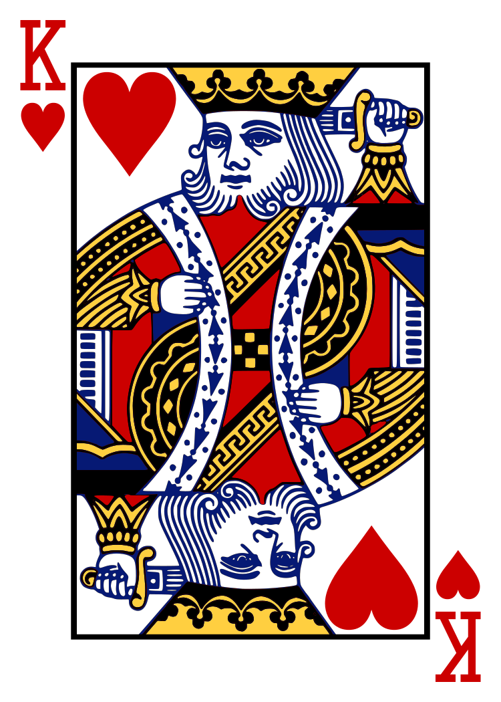
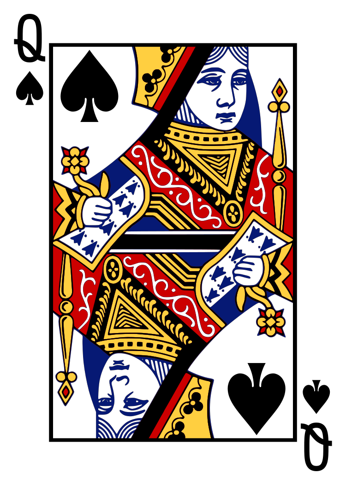
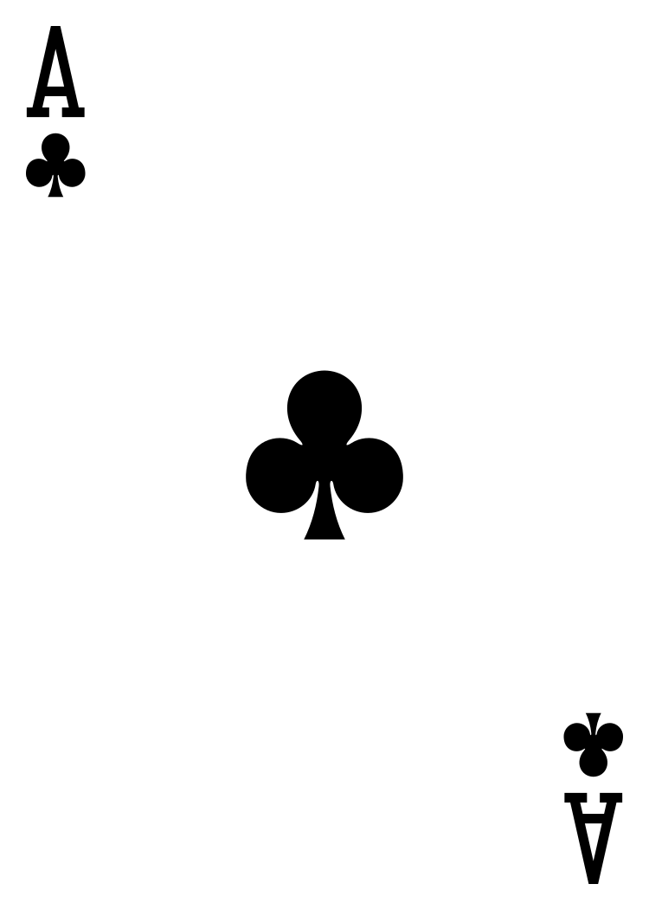

<!-- tp-docgen:page-layout:v2 -->
<!-- -->
# <tp-icon name="memory" library="components" size="1.25em"></tp-icon> Memory

<div class="tp-component-doc-overview">

<div class="tp-component-doc-toc">
<tp-toc position="end" expand-all></tp-toc>
</div>

<div class="tp-component-doc-intro">

The custom `<tp-memory>` element creates a memory matching game.

<div class="tp-component-doc-example">

<!-- tp-docgen:introduction:start -->
<tp-memory label="Match the fruits">
  <ol><li>Apple</li><li>Pear</li><li>Plum</li></ol>
</tp-memory>
<!-- tp-docgen:introduction:end -->

</div>

</div>

</div>

<!-- -->
## Component viewer

<tp-component-viewer tag="tp-memory" src="/docs/components/memory/examples/introduction.html"></tp-component-viewer>

<!-- -->
## Usage

### Authoring

Provide one `<li>` for each distinct pair. The list may be an `<ol>` or a `<ul>` and each item can contain text, images, SVG, or other `tp-*` components. With `n` items, `<tp-memory>` creates `2 × n` flip cards.

Memory cards use `button-position="none"`: click directly on a card to turn it over.

```html
<tp-memory>
  <ol>
    <li></li>
    <li></li>
    <li></li>
  </ol>
</tp-memory>
```

Cards adapt their width and height to their content. Images and SVGs retain their proportions and are limited to `--tp-memory-card-max-width`.

The default card back is the blue OpenDecks SVG. Use `back="blue"` or `back="red"` for the two bundled playing-card backs, or provide an image URL such as a `logo-tp-*` SVG. Use `mismatch-delay` to change the 1000 ms delay.

### History

Undo and Redo revisit completed pair attempts without reshuffling the cards. They are unavailable during the unmatched-pair animation. Reset begins a new shuffled game and clears the recorded attempts.

### Importing

::: tp-tabs
script
: Autoloading:

  ```html
  <script type="module" src="tp-loader.js"></script>
  ```

  Cherry picking:

  ```html
  <script type="module" src="/path/to/components/memory/memory.js"></script>
  ```

import
: ```js
  import "/path/to/components/memory/memory.js";
  ```

bundler
: ```js
  import "@tp/tp-components/components/memory/memory.js";
  ```
:::

<!-- -->
## Examples

<!-- tp-docgen:example-descriptions:start -->
Basic usage
: Reveal cards and find matching pairs, remembering their positions.

Javascript API
: Create the Basic usage example entirely with JavaScript and explicit component imports. Run the example to obtain the same content and interactions without the autoloader.

Numbers 0 to 9
: Find pairs of matching number cards.

European Union flags
: Find matching pairs of flag images.
<!-- tp-docgen:example-descriptions:end -->

::::::::::::::: tp-tabs
<tp-icon name="file_type_html" library="languages" size="1.25em"></tp-icon> HTML
: ::include{examples/examples.html}

<tp-icon name="file_type_asciidoc" library="languages" size="1.25em"></tp-icon> tp-asciidoc
: ::include{examples/examples.adoc}

<tp-icon name="file_type_latex" library="languages" size="1.25em"></tp-icon> tp-latex
: ::include{examples/examples-latex.html}

<tp-icon name="file_type_markdown" library="languages" size="1.25em"></tp-icon> tp-markdown
: ::include{examples/examples.md}

<tp-icon name="file_type_restructuredtext" library="languages" size="1.25em"></tp-icon> tp-restructuredtext
: ::include{examples/examples.rst}
:::::::::::::::

<!-- -->
<!-- tp-docgen:dependencies:start -->
## Dependencies

All tp-components and external tools used by this component are loaded automatically by this component if they have not already been loaded by another component.

### Internal

<!--
@tp-dependency tp-base
@summary Shared base class for tp-* components.
-->
<!--
@tp-dependency tp-chronometer
@summary Chronometer component with play, pause and stop controls.
-->
<!--
@tp-dependency tp-color
@summary Brand color preset controller scoped to the containing element.
-->
<!--
@tp-dependency tp-divider
@summary Visual separator for menus, dropdowns, toolbars, and layouts.
-->
<!--
@tp-dependency tp-drawer
@summary Drawer overlay component.
-->
<!--
@tp-dependency tp-dropdown
@summary Dropdown menu component.
-->
<!--
@tp-dependency tp-flip-card
@summary Two-sided card component.
-->
<!--
@tp-dependency tp-fullscreen
@summary Fullscreen controller button.
-->
<!--
@tp-dependency tp-icon
@summary SVG icon component with inline, URL, and registry sources.
-->
<!--
@tp-dependency tp-icon-button
@summary Accessible icon button component.
-->
<!--
@tp-dependency tp-switcher
@summary Switches between horizontal and vertical layouts based on available space.
-->
<!--
@tp-dependency tp-theme
@summary Parent-scoped light/dark/auto theme controller with embedded UI.
-->

- [`<tp-base>`](#/components/base/index.md) : Shared base class for tp-* components.
- [`<tp-chronometer>`](#/components/chronometer/index.md) : Chronometer component with play, pause and stop controls.
- [`<tp-color>`](#/components/color/index.md) : Brand color preset controller scoped to the containing element.
- [`<tp-divider>`](#/components/divider/index.md) : Visual separator for menus, dropdowns, toolbars, and layouts.
- [`<tp-drawer>`](#/components/drawer/index.md) : Drawer overlay component.
- [`<tp-dropdown>`](#/components/dropdown/index.md) : Dropdown menu component.
- [`<tp-flip-card>`](#/components/flip-card/index.md) : Two-sided card component.
- [`<tp-fullscreen>`](#/components/fullscreen/index.md) : Fullscreen controller button.
- [`<tp-icon>`](#/components/icon/index.md) : SVG icon component with inline, URL, and registry sources.
- [`<tp-icon-button>`](#/components/icon-button/index.md) : Accessible icon button component.
- [`<tp-switcher>`](#/components/switcher/index.md) : Switches between horizontal and vertical layouts based on available space.
- [`<tp-theme>`](#/components/theme/index.md) : Parent-scoped light/dark/auto theme controller with embedded UI.

### External

<!--
@summary No external dependency.
-->
No external dependency
<!-- tp-docgen:dependencies:end -->
