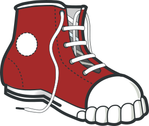

<!-- tp-docgen:page-layout:v2 -->
<!-- -->
# <tp-icon name="carousel" library="components" size="1.25em"></tp-icon> Carousel

<div class="tp-component-doc-overview">

<div class="tp-component-doc-toc">
<tp-toc position="end" expand-all></tp-toc>
</div>

<div class="tp-component-doc-intro">

The custom `<tp-carousel>` element displays images one at a time in a horizontal or vertical carousel.

<div class="tp-component-doc-example">

<!-- tp-docgen:introduction:start -->
<tp-carousel aria-label="Outdoor activities" height="18rem">
  
  
  
</tp-carousel>
<!-- tp-docgen:introduction:end -->

</div>

</div>

</div>

<!-- -->
## Component viewer

<tp-component-viewer tag="tp-carousel" src="/docs/components/carousel/examples/introduction.html"></tp-component-viewer>

<!-- -->
## Usage

### Authoring

Place images inside the carousel and provide meaningful `alt` text. A `picture` or a `figure` with an image and caption can also represent a slide. Give the carousel an `aria-label` that identifies its contents.

Set `orientation="vertical"` for vertical navigation; the default is `horizontal`. Set `height` to the image viewport height (default `20rem`). Images retain their proportions and fit inside this viewport.

`index` selects an image by its zero-based position. Add the boolean `loop` attribute to let the Previous and Next commands wrap between the first and last images. Navigation is manual by default. Set `auto="2000"` to advance every 2,000 milliseconds and automatically wrap from the last image to the first, even without `loop`. Set `auto="0"` (the default) or remove the attribute to stop automatic navigation. Negative and non-finite values also disable it. Changing the interval takes effect immediately. Manual navigation remains available. Hovering over the carousel pauses both automatic navigation and any running transition. Moving the pointer away resumes the movement from the same position, with the remaining time before the next image.

```html
<tp-carousel auto="2000" height="3em" aria-label="TP markup languages">
  
  
  
</tp-carousel>
```

Add the boolean `hide-controls` attribute to hide both navigation buttons and the counter, without leaving space below the images. Automatic navigation, keyboard navigation and touch scrolling remain available. Remove the attribute to show the controls again. The JavaScript property is `hideControls`.

The viewport background is transparent by default. Set `bg-color="brand"` or `bg-color="neutral"` for a theme-aware TP background, or use a CSS color such as `bg-color="#eeeeee"` or `bg-color="var(--tp-paper-color)"`. Remove the attribute to restore transparency.

Set `transition="start-to-end"` to move each selected slide all the way from outside the left edge to outside the right edge, without stopping in the middle. `transition="end-to-start"` reverses this motion. Directions follow the reading direction; vertical carousels use top-to-bottom and bottom-to-top respectively. With `auto="2000"`, each traversal lasts two seconds at constant speed, then the next slide starts at the entrance edge as soon as the previous image has fully left. The travel distance follows the visible image or icon bounds to avoid off-screen waiting time. The first slide starts moving as soon as the carousel is ready. Without automatic navigation, a manually selected slide traverses in 400 milliseconds. The default `transition="none"` keeps automatic changes immediate. Reduced-motion preferences disable the movement and keep the selected slide visible.

```html
<tp-carousel auto="2000" hide-controls height="3em" bg-color="transparent" transition="start-to-end">
  <figure><tp-icon name="tp-html-logo" library="tp" size="3em" role="img" aria-label="TP HTML"></tp-icon></figure>
  <figure><tp-icon name="tp-markdown-logo" library="tp" size="3em" role="img" aria-label="TP Markdown"></tp-icon></figure>
</tp-carousel>
```

Use `previous()`, `next()` or `goTo(index)` to select an image from JavaScript. The `tp-carousel-change` event provides `{ index, count }` in `event.detail`.

Use [tp-slider](#/components/slider/index.md) for a freely scrolling strip of arbitrary content; use `tp-carousel` for an image gallery with one image per view and navigation controls.

### Importing

::: tp-tabs
script
: Autoloading:

  ```html
  <script type="module" src="tp-loader.js"></script>
  ```

  Cherry picking:

  ```html
  <script type="module" src="/path/to/components/carousel/carousel.js"></script>
  ```

import
: ```js
  import "/path/to/components/carousel/carousel.js";
  ```

bundler
: ```js
  import "@tp/tp-components/components/carousel/carousel.js";
  ```
:::

<!-- -->
## Examples

<!-- tp-docgen:example-descriptions:start -->
Basic usage
: Use Previous image and Next image to browse three illustrations, or focus the image viewport and use the arrow keys.

Javascript API
: Create the Basic usage example entirely with JavaScript and explicit component imports. Run the example to obtain the same content and interactions without the autoloader.

Vertical navigation
: Browse the images vertically using the buttons, a vertical swipe or the Up and Down arrow keys.

Looping navigation
: Use Next image after the last illustration to return to the first; Previous image also wraps in the other direction.

Automatic scrolling and hover pause
: Watch the five TP markup logos travel from left to right every three seconds in a 3em-high carousel, without buttons or a counter. Hover to pause, then move the pointer away to resume from the same position.
<!-- tp-docgen:example-descriptions:end -->

::::::::::::::: tp-tabs
:tp-icon:{name="file_type_html" library="languages" size="1.25em" aria-hidden="true"} HTML
: ::include{examples/examples.html}

:tp-icon:{name="file_type_asciidoc" library="languages" size="1.25em" aria-hidden="true"} tp-asciidoc
: ::include{examples/examples.adoc}

:tp-icon:{name="file_type_latex" library="languages" size="1.25em" aria-hidden="true"} tp-latex
: ::include{examples/examples-latex.html}

:tp-icon:{name="file_type_markdown" library="languages" size="1.25em" aria-hidden="true"} tp-markdown
: ::include{examples/examples.md}

:tp-icon:{name="file_type_restructuredtext" library="languages" size="1.25em" aria-hidden="true"} tp-restructuredtext
: ::include{examples/examples.rst}
:::::::::::::::

<!-- -->
<!-- tp-docgen:dependencies:start -->
## Dependencies

All tp-components and external tools used by this component are loaded automatically by this component if they have not already been loaded by another component.

### Internal

<!--
@tp-dependency tp-base
@summary Shared base class for tp-* components.
-->
<!--
@tp-dependency tp-icon-button
@summary Accessible icon button component.
-->
<!--
@tp-dependency tp-slider
@summary Arranges content in a horizontally or vertically scrollable strip.
-->

- [`<tp-base>`](#/components/base/index.md) : Shared base class for tp-* components.
- [`<tp-icon-button>`](#/components/icon-button/index.md) : Accessible icon button component.
- [`<tp-slider>`](#/components/slider/index.md) : Arranges content in a horizontally or vertically scrollable strip.

### External

<!--
@summary No external dependency.
-->
No external dependency

### See also

- [`<tp-slider>`](#/components/slider/index.md) : Provides the scrollable strip used by the carousel.
<!-- tp-docgen:dependencies:end -->
